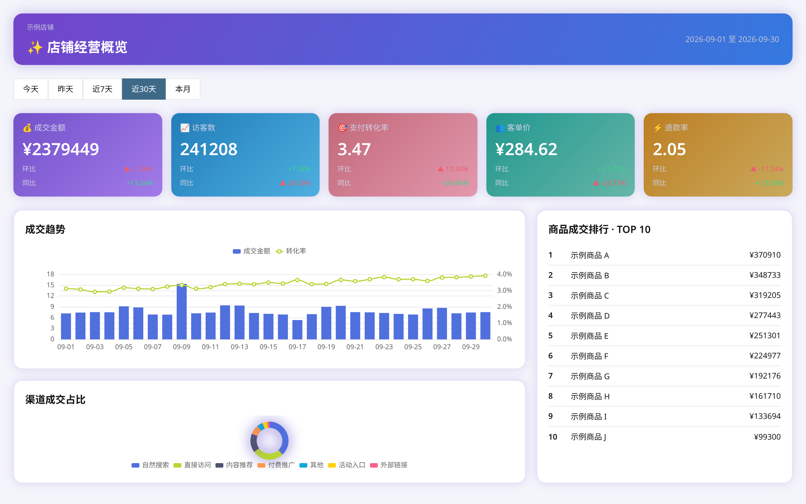
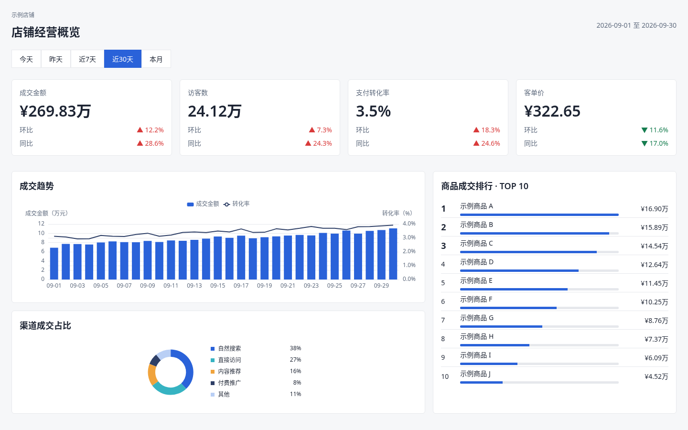

English | [简体中文](README.zh-CN.md)

# dashtaste

Two style-pack skills for coding agents, plus a `dashtaste check` CLI for chart configs and rendered dashboards.

| Before                              | After                             |
| ----------------------------------- | --------------------------------- |
|  |  |

## Install the skill

Choose a pack for the dashboard's audience:

```sh
npx skills add FelixFangX/dashtaste --skill dashtaste-global
npx skills add FelixFangX/dashtaste --skill dashtaste-cn
```

For manual installation, copy the folder from [skills/](skills/) into your agent's skills directory. Ask the agent to follow the selected skill when building or reviewing a dashboard.

## Check

```sh
npx dashtaste check dashboard.json --pack cn
npx dashtaste check http://localhost:5173 --pack global
npx dashtaste check dashboard.json --pack cn --format json
npx dashtaste check dashboard.json --pack cn --disable DT003,DT005
```

The package is not published yet. To run this checkout, use Node 20.19 or newer and pnpm:

```sh
pnpm install
pnpm build
node dist/cli.js check gallery/pages/store/before.html --pack cn --only DT003,DT005,DT010
```

Actual output from that three-rule gallery check:

```text
gallery/pages/store/before.html
  warn  DT003  charts[0].series[1]  smooth line  → use straight segments: smooth: false
  warn  DT005  charts[1].series[0]  pie slices  → use horizontal bars or combine small parts into Other
  error  DT010  charts[0].yAxis[0]  bar baseline  → set min: 0 and scale: false
1 error, 2 warnings · score 84/100
```

Exit codes: `0` passes, `1` means errors or warnings above the limit, and `2` means invalid input or unavailable extraction. Warnings have no limit by default; use `--max-warnings 0` to require none. Use `--mode dark` for dark pages. JSON output includes findings, paths, fixes, and scores. Every rule can be disabled with `--disable` and comma-separated IDs.

Scores start at 100, subtract 10 per error, 3 per warning, and 1 per informational finding, with a floor of zero. See [usage](docs/usage.md) for all flags and input shapes.

## Packs

| Choice        | global                           | cn                                                        |
| ------------- | -------------------------------- | --------------------------------------------------------- |
| Deltas        | Green up, red down; arrows       | Red up, green down; arrows                                |
| Units         | K / M / B                        | 万 / 亿                                                   |
| KPI layout    | One strip with dividers          | Flat cards; 环比 and 同比 rows                            |
| Legend        | Omit for one series              | Omit for one series; direct category labels work for pies |
| Pie           | At most five slices; prefer bars | At most five slices; rose charts allow eight              |
| Dark / screen | Paper and ink dark tokens        | Navy panels; 1920×1080 screen composition                 |

Both packs specify spacing, typography, chart defaults, and number formatting. Layout still needs human review.

## Rules

[Reasons, triggers, and fixes](docs/rules.md) for every rule:

| ID    | Name                 |
| ----- | -------------------- |
| DT001 | default-palette      |
| DT002 | rainbow-palette      |
| DT003 | smooth-line          |
| DT004 | symbols-everywhere   |
| DT005 | pie-slices           |
| DT006 | pie-overuse          |
| DT007 | three-d              |
| DT008 | dual-axis            |
| DT009 | missing-unit         |
| DT010 | bar-baseline         |
| DT011 | raw-large-numbers    |
| DT012 | unit-system          |
| DT013 | delta-convention     |
| DT014 | delta-colour-only    |
| DT015 | low-contrast-text    |
| DT016 | thin-line-contrast   |
| DT017 | gradient-decoration  |
| DT018 | glow                 |
| DT019 | kpi-overload         |
| DT020 | kpi-rainbow          |
| DT021 | emoji-icons          |
| DT022 | cjk-min-size         |
| DT023 | legend-single-series |

## Gallery

All data is fictional and seeded in [gallery/data.mjs](gallery/data.mjs). Each pair shares the same data. Before pages use common unguided defaults; after pages apply their pack. These are style checks, not a usability benchmark.

| Dashboard | Before score                    | After score                      |
| --------- | ------------------------------- | -------------------------------- |
| saas      | [0](gallery/saas-before.png)    | [100](gallery/saas-after.png)    |
| finance   | [0](gallery/finance-before.png) | [100](gallery/finance-after.png) |
| store     | [0](gallery/store-before.png)   | [100](gallery/store-after.png)   |
| live      | [0](gallery/live-before.png)    | [100](gallery/live-after.png)    |

Revenue uses global light; finance uses global dark; store uses cn light; live uses cn dark at 1920×1080. Other pages use 1440×900.

```sh
pnpm gallery
```

This builds the CLI, copies local ECharts into the ignored `gallery/vendor/` folder, renders eight PNGs, and writes [results.json](gallery/results.json). No CDN or network fonts are used. Set `CHROME_PATH` to your local Chromium executable; the default is `/usr/bin/google-chrome`. The browser test extracts each live page again instead of trusting saved scores.

## Status

Early. Not published to npm yet.

ECharts only for now. Vega-Lite and Recharts are planned. HTML mode needs a local Chromium. Rules are opinions with reasons; every rule can be disabled.

## License

[MIT](LICENSE).
