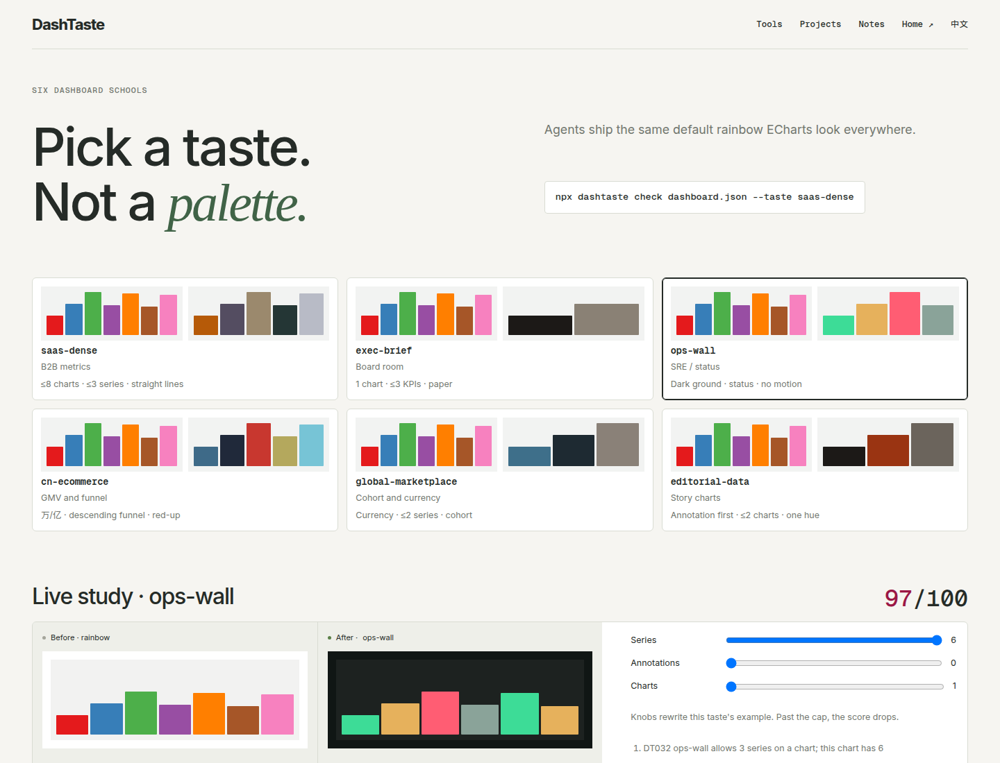
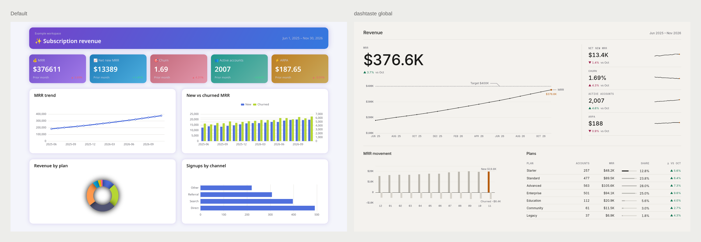

# Agents ship the same default rainbow ECharts look everywhere.

Pick a named taste, check a dashboard against that school, and install its tokens. Not one shared palette.

```sh
npx dashtaste check dashboard.json --taste saas-dense
```

[](https://www.npmjs.com/package/dashtaste)
[](https://dashtaste.ledring.dev)

## Tastes

| Taste                | School              | What the check enforces                                                  |
| -------------------- | ------------------- | ------------------------------------------------------------------------ |
| `saas-dense`         | B2B metrics         | ≤ 8 charts, ≤ 3 series, straight lines, animation off. `--pack global`   |
| `exec-brief`         | Board room          | 1 chart, ≤ 3 KPIs, ≤ 1 story annotation, paper ground                    |
| `ops-wall`           | SRE / status        | Near-black ground (error if the page is light), status colours, ≤ 8 KPIs |
| `cn-ecommerce`       | GMV and funnel      | 万/亿 ticks, ≤ 4 descending funnels, ≤ 4 series. `--pack cn`             |
| `global-marketplace` | Cohort and currency | A currency mark on every value axis, ≤ 2 series, ≤ 4 charts              |
| `editorial-data`     | Story charts        | At least one story annotation, ≤ 2 charts, paper ground                  |

```sh
npx dashtaste tastes
npx dashtaste tokens --taste editorial-data
npx dashtaste example --taste ops-wall
npx dashtaste apply --taste cn-ecommerce
```

`tastes` lists the catalog. `tokens --taste` prints that school's colours and the rules sentence the checker uses. `example --taste` prints an option that scores 100 under that taste. `apply --taste` writes `tokens.json` and `example.json`. Each taste is tokens plus composition — chart count, series count, KPI cap, annotation range, ground, motion, units — not a color swap of the same dashboard.

The [demo](https://dashtaste.ledring.dev) opens on the six tastes. Before is the rainbow. After uses that taste. Series, annotations, and charts are knobs. Past the cap, the score drops.



## Pack aliases

| `--pack` | Taste          |
| -------- | -------------- |
| `global` | `saas-dense`   |
| `cn`     | `cn-ecommerce` |

`--pack` still works. `--taste` and `--pack` together are an error when they name different schools. With neither flag, the check is `saas-dense`.



## Check

```sh
npx dashtaste check dashboard.json --taste saas-dense
npx dashtaste check dashboard.json --pack cn
npx dashtaste check dashboard.json --taste cn-ecommerce --format json
```

Node 20 or newer. Input is one ECharts option, an array of options, or a page-facts envelope. A URL or HTML file also needs the optional `playwright-core` dependency and a local Chromium (`CHROME_PATH`).

From a checkout:

```sh
pnpm install
pnpm build
node dist/cli.js check test/fixtures/bad.json --taste saas-dense
```

That fixture prints:

```text
test/fixtures/bad.json
  error  DT001  charts[0]  default ECharts palette  → set option.color to the pack palette (dashtaste tokens --pack global)
  warn  DT003  charts[0].series[1]  smooth line  → use straight segments: smooth: false
  warn  DT004  charts[0].series[1]  symbols everywhere  → use dots at most 5px on at most 31 points, or set showSymbol: false
  warn  DT009  charts[0].yAxis[0]  missing unit  → put units in axis names, rendered ticks, or formatter metadata
  error  DT010  charts[0].yAxis[0]  bar baseline  → set min: 0 and scale: false
  warn  DT011  charts[0].yAxis[0].axisLabel  raw large numbers  → format compact units: cn 万/亿; global K/M
  warn  DT011  charts[0].tooltip  raw large numbers  → format compact units: cn 万/亿; global K/M
  warn  DT024  charts[0].series[0]  bar width  → set barMaxWidth to 24 or less; use 32 or less on screens
2 errors, 6 warnings · score 62/100 · saas-dense
```

Exit 0 when there are no errors and warnings are within `--max-warnings` (no limit by default). Exit 1 when any finding is an error, or warnings exceed that limit. Exit 2 when the file or the flags are invalid. Info findings change the score and leave the exit code at 0. `--format json` prints `{ version, pack, taste, inputs, summary }`. Each finding has `ruleId`, `severity`, `message`, `path`, and `fix`. Any rule can be skipped with `--disable`.

The score starts at 100. Each error subtracts 10, each warning 3, each info 1, with a floor of 0.

```ts
import { check } from 'dashtaste';

const findings = check({ series: [] }, { taste: 'saas-dense' });
```

`{ pack: 'global' }` checks `saas-dense`. `{ pack: 'cn' }` checks `cn-ecommerce`. `rules` lists rule metadata. `tokens --pack` still prints that pack's colours. `tokens --taste` prints the taste. Flags are in [usage](docs/usage.md). `--pack-file` extends a built-in pack; see [packs](docs/packs.md).

## Skills

```sh
npx skills add FelixFangX/dashtaste --skill dashtaste
```

`dashtaste` is the selector: it lists the six tastes and tells the agent to check with `--taste`. `dashtaste-global` follows `saas-dense` (`--pack global`). `dashtaste-cn` follows `cn-ecommerce` (`--pack cn`).

```sh
npx skills add FelixFangX/dashtaste --skill dashtaste-global
npx skills add FelixFangX/dashtaste --skill dashtaste-cn
```

Or copy `skills/dashtaste` into the agent's skills directory and tell it to follow that skill.

## Packs

`global` is the `saas-dense` alias: green-up, K / M / B, at most 6 KPIs, and at most 5 pie or rose slices. `cn` is the `cn-ecommerce` alias: red-up, 万 / 亿, at most 8 KPIs, at most 5 pie slices, and at most 8 rose slices. `cn` defines a 1920×1080 screen. `DT022` runs on the cn pack only.

Pass `--mode dark` for a dark page. `ops-wall` defaults to dark. Both packs have light and dark tokens. The six tastes add composition on top of those packs.

## Rules

[Reasons, triggers, and fixes](docs/rules.md).

| ID    | Default | Name                    |
| ----- | ------- | ----------------------- |
| DT001 | error   | default-palette         |
| DT002 | warn    | rainbow-palette         |
| DT003 | warn    | smooth-line             |
| DT004 | warn    | symbols-everywhere      |
| DT005 | warn    | pie-slices              |
| DT006 | warn    | pie-overuse             |
| DT007 | error   | three-d                 |
| DT008 | warn    | dual-axis               |
| DT009 | warn    | missing-unit            |
| DT010 | error   | bar-baseline            |
| DT011 | warn    | raw-large-numbers       |
| DT012 | warn    | unit-system             |
| DT013 | error   | delta-convention        |
| DT014 | warn    | delta-colour-only       |
| DT015 | error   | low-contrast-text       |
| DT016 | warn    | thin-line-contrast      |
| DT017 | warn    | gradient-decoration     |
| DT018 | warn    | glow                    |
| DT019 | warn    | kpi-overload            |
| DT020 | warn    | kpi-rainbow             |
| DT021 | warn    | emoji-icons             |
| DT022 | warn    | cjk-min-size            |
| DT023 | info    | legend-single-series    |
| DT024 | warn    | bar-width               |
| DT025 | warn    | legend-not-direct-label |
| DT026 | warn    | line-weight             |
| DT027 | warn    | tabular-numerals        |
| DT028 | info    | hero-metric             |
| DT029 | warn    | helper-captions         |
| DT030 | error   | taste-rainbow           |
| DT031 | warn    | taste-chart-cap         |
| DT032 | warn    | taste-series-cap        |
| DT033 | warn    | taste-annotation        |
| DT034 | warn    | taste-motion            |
| DT035 | warn    | taste-ground            |
| DT036 | warn    | taste-currency          |
| DT037 | warn    | taste-funnel            |
| DT038 | warn    | taste-palette           |

## Gallery

[dashtaste.ledring.dev](https://dashtaste.ledring.dev)

The first screen is the catalog: six tastes, each with a rainbow before and that taste's after. Series, annotations, and charts are knobs. Past the cap, the specimen score drops. The four dashboards below are worked pages for the `saas-dense` and `cn-ecommerce` aliases.

Gallery data is fictional, seeded in [gallery/data.mjs](gallery/data.mjs). Each pair shares that data. Before pages use unguided defaults. After pages follow the pack. Counts are from [gallery/results.json](gallery/results.json). A score of 100 means the page matched the rules.

| Dashboard | Pack, mode          | Before                                  | After     |
| --------- | ------------------- | --------------------------------------- | --------- |
| saas      | global, light       | 37 errors, 55 warnings, 2 info, score 0 | score 100 |
| finance   | global, dark        | 7 errors, 46 warnings, 1 info, score 0  | score 100 |
| store     | cn, light           | 47 errors, 71 warnings, 2 info, score 0 | score 100 |
| live      | cn, dark, 1920×1080 | 37 errors, 88 warnings, 1 info, score 0 | score 100 |

Walkthroughs: [docs/cases](docs/cases/).

- [saas](gallery/compare/saas-wide.png)
- [finance](gallery/compare/finance-wide.png)
- [store](gallery/compare/store-wide.png)
- [live](gallery/compare/live-wide.png)

```sh
pnpm gallery
```

This builds the CLI, renders the gallery PNGs, and writes `gallery/results.json`. It needs `playwright-core`. Set `CHROME_PATH` to Chromium. The default is `/usr/bin/google-chrome`.

## MCP

Agents start the stdio server with:

```sh
npx dashtaste mcp
```

From a checkout: `pnpm install && pnpm build`, then `node dist/cli.js mcp` or `node dist/mcp/server.js`. `dashtaste-mcp` is the same server.

```json
{
  "mcpServers": {
    "dashtaste": {
      "command": "npx",
      "args": ["-y", "dashtaste", "mcp"]
    }
  }
}
```

- `list_tastes` returns the six schools, tokens, composition, and the rules sentence.
- `taste_tokens` takes `{ "taste": "editorial-data" }`. Same payload as `tokens --taste`.
- `taste_example` takes `{ "taste": "ops-wall" }` and returns an option that scores 100.
- `check_taste` takes `option` or `optionJson`, plus optional `taste`, `pack`, and `mode`. The default taste is `saas-dense`. A rainbow palette is an error.
- `apply_taste` takes `{ "taste": "cn-ecommerce" }` and returns the `tokens.json` and `example.json` bodies. `out` also writes those files.

0.0.8. Rules can change in any 0.x release.

## License

[MIT](LICENSE).
