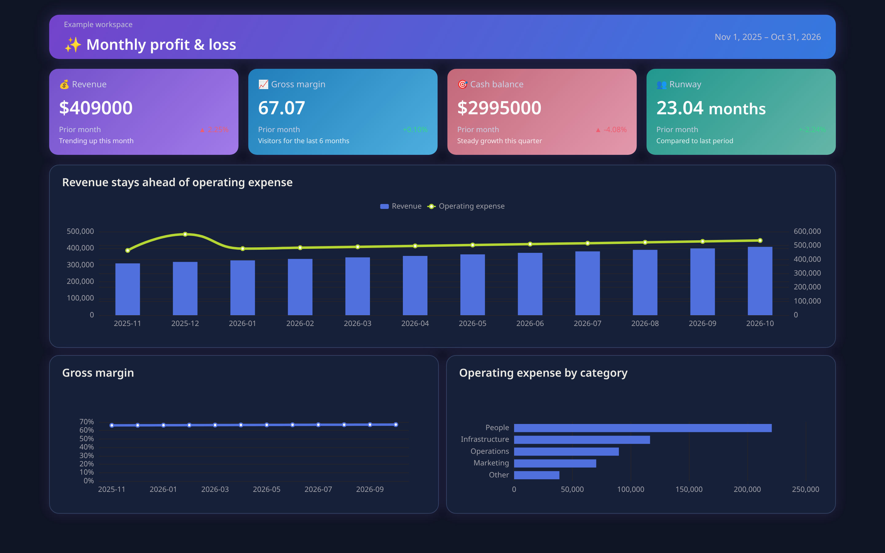
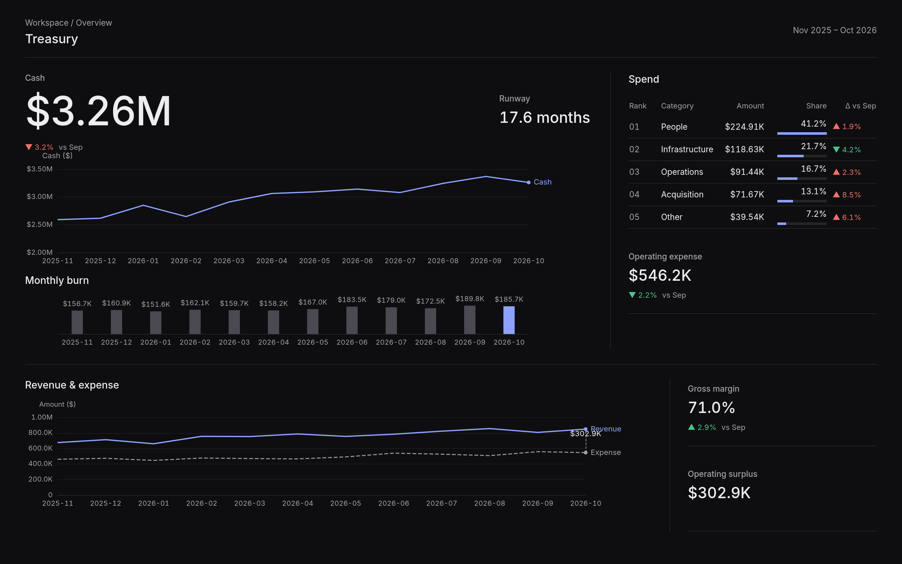

# Case: Finance (global, dark)

**Audience:** Global finance / treasury dashboard  
**Pack:** `global` · **Mode:** dark · **Viewport:** 1440×900  
**Source:** [gallery/pages/finance](../../gallery/pages/finance/) · scores in [results.json](../../gallery/results.json)

The pair shares the same fictional seed data: unguided before vs pack-aligned after. The layout establishes priority without helper sentences that repeat the visible metrics.

## Scores

| Variant | Errors | Warnings | Score |
| ------- | ------ | -------- | ----- |
| before  | 7 | 46 | 0 |
| after   | 0 | 0 | 100 |

Before rule IDs (from `results.json`): DT001, DT002, DT003, DT004, DT008, DT009, DT010, DT011, DT013, DT017, DT018, DT021, DT024, DT026, DT027, DT028, DT029.

## What the before page trips on

Concrete smells that show up in the check (not an exhaustive list):

- **DT001 / DT002** — default and rainbow series palettes
- **DT003 / DT004** — smooth lines and repeated point symbols
- **DT008 / DT010** — dual value axes and a nonzero bar baseline
- **DT009 / DT011** — missing units and unformatted large numbers
- **DT028 / DT029** — equal-sized KPIs and filler helper captions

## What after applies (global pack)

- Cash is the hero metric; runway, burn, spend, and revenue provide supporting context (DT028)
- Global compact money units and polarity-aware deltas: green for improvement, red for deterioration (DT009, DT011, DT013)
- Straight lines, one value axis per chart, and zero-based burn bars (DT003, DT008, DT010)
- Solid dark surfaces, restrained chart colours, and no decorative gradients or glow (DT001, DT002, DT017, DT018)
- Tabular KPI numerals and no helper sentences beneath values (DT027, DT029)

After score 100 means these rules are satisfied for this HTML page. It is not a claim about conversion, readability studies, or production traffic.

## Images

| Before | After | Side-by-side |
| ------ | ----- | ------------ |
|  |  | [wide compare](../../gallery/compare/finance-wide.png) · [tall compare](../../gallery/compare/finance-tall.png) |

## Reproduce

From a checkout (build once if `dist/` is missing):

```sh
pnpm build
node dist/cli.js check gallery/pages/finance/before.html --pack global --mode dark
node dist/cli.js check gallery/pages/finance/after.html --pack global --mode dark
```

HTML checks need a local Chromium (`CHROME_PATH`). Rule reasons: [docs/rules.md](../rules.md).
