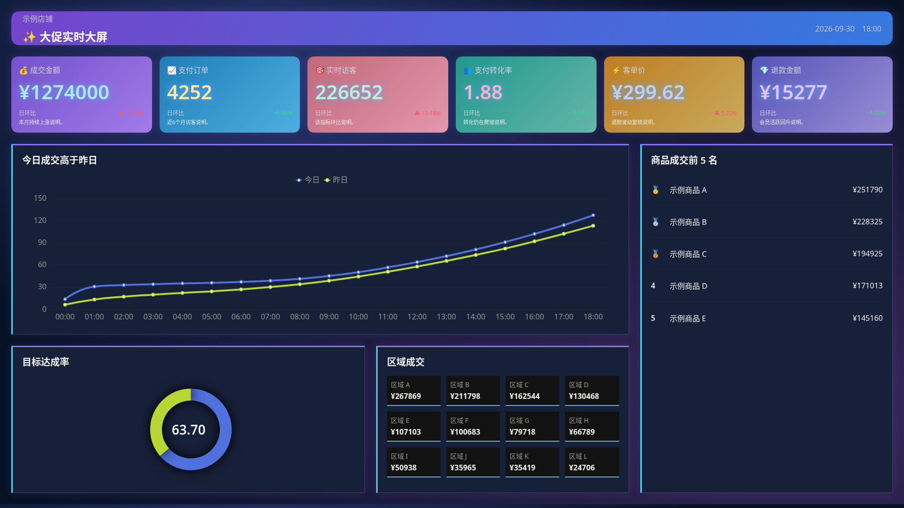
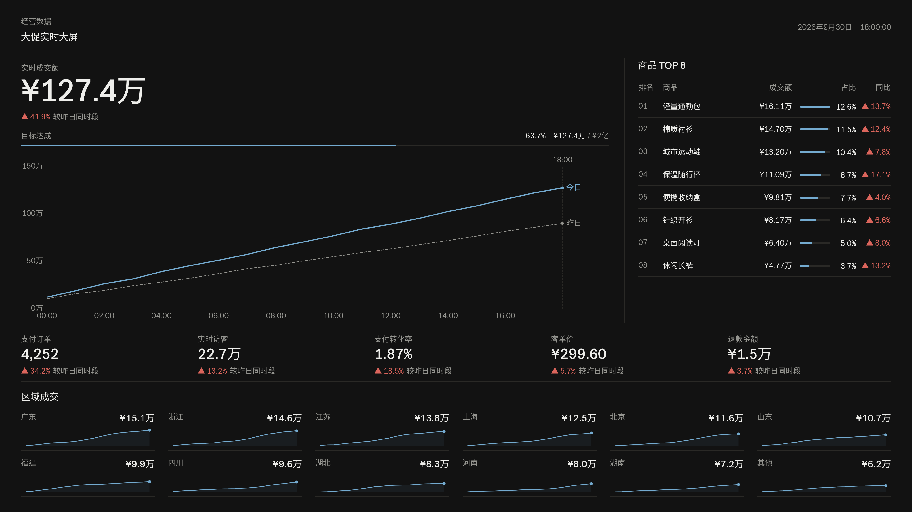

# Case: Live operations (cn, dark)

**Audience:** Chinese retail / live campaign operations screen  
**Pack:** `cn` · **Mode:** dark · **Viewport:** 1920×1080  
**Source:** [gallery/pages/live](../../gallery/pages/live/) · scores in [results.json](../../gallery/results.json)

The pair shares the same fictional seed data: unguided before vs pack-aligned after. The layout establishes priority without helper sentences that repeat the visible metrics.

## Scores

| Variant | Errors | Warnings | Score |
| ------- | ------ | -------- | ----- |
| before  | 37 | 88 | 0 |
| after   | 0 | 0 | 100 |

Before rule IDs (from `results.json`): DT001, DT002, DT003, DT004, DT009, DT013, DT015, DT017, DT018, DT020, DT021, DT022, DT025, DT026, DT027, DT028, DT029.

## What the before page trips on

Concrete smells that show up in the check (not an exhaustive list):

- **DT001 / DT002** — default and rainbow series palettes
- **DT003 / DT004** — smooth lines and repeated point symbols
- **DT015 / DT022** — low-contrast text and undersized CJK labels
- **DT020 / DT025** — competing KPI accents and legends instead of direct line labels
- **DT028 / DT029** — no clear hero metric and unnecessary helper captions

## What after applies (cn pack)

- Live transaction value anchors the 1920×1080 screen; secondary KPIs and ranked products support it (DT028)
- Compact wan / yi units and cn red-up / green-down deltas with direction markers (DT009, DT013)
- Straight comparison lines with direct end labels and controlled line weights (DT003, DT025, DT026)
- Solid dark surfaces, readable CJK labels, and no decorative gradients or glow (DT015, DT017, DT018, DT022)
- Neutral KPI values, tabular numerals, and no filler helper captions; hierarchy and alignment explain the layout (DT020, DT027, DT029)

After score 100 means these rules are satisfied for this HTML page. It is not a claim about conversion, readability studies, or production traffic.

## Images

| Before | After | Side-by-side |
| ------ | ----- | ------------ |
|  |  | [wide compare](../../gallery/compare/live-wide.png) · [tall compare](../../gallery/compare/live-tall.png) |

## Reproduce

From a checkout (build once if `dist/` is missing):

```sh
pnpm build
node dist/cli.js check gallery/pages/live/before.html --pack cn --mode dark
node dist/cli.js check gallery/pages/live/after.html --pack cn --mode dark
```

HTML checks need a local Chromium (`CHROME_PATH`). Rule reasons: [docs/rules.md](../rules.md).
