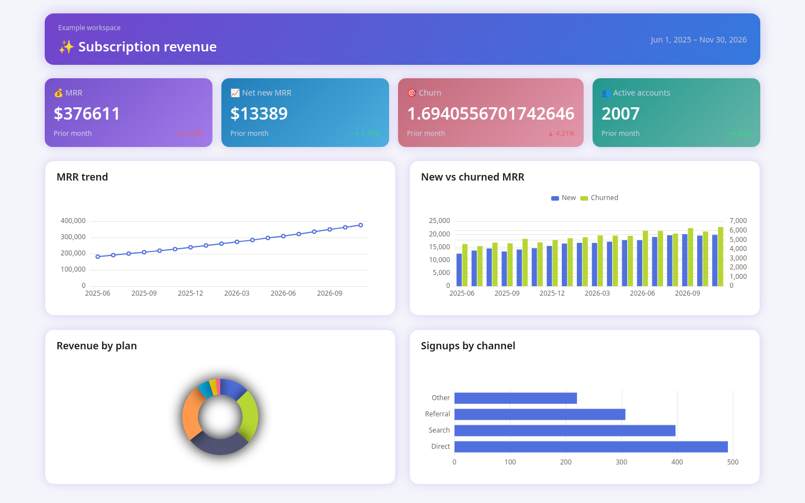
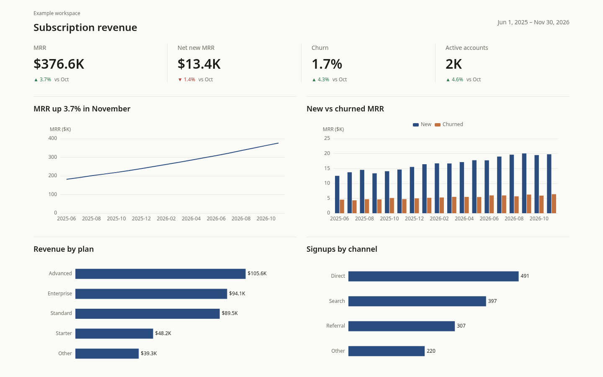

# Case: SaaS (global, light)

**Audience:** Global product / SaaS dashboard  
**Pack:** `global` · **Mode:** light · **Viewport:** 1440×900  
**Source:** [gallery/pages/saas](../../gallery/pages/saas/) · scores in [results.json](../../gallery/results.json)

Same pattern as the [store cn case](store-cn.md): identical fictional data, unguided before vs pack-aligned after.

## Scores

| Variant | Errors | Warnings | Score |
| ------- | ------ | -------- | ----- |
| before  | 37     | 55       | 0     |
| after   | 0      | 0        | 100   |

Before rule IDs: DT001, DT002, DT003, DT004, DT005, DT006, DT008, DT009, DT010, DT011, DT013, DT015, DT017, DT018, DT021, DT024, DT026, DT027, DT028, DT029.

## Notes

- Global pack: green-up / red-down; K / M / B units; one KPI strip with dividers
- Before also hits **DT006** (pie overuse) and **DT011** (raw large numbers) in addition to the usual default-palette / smooth / helper-caption set
- Clean after = rule consistency for this page, not a UX benchmark

## Images

| Before | After | Side-by-side |
| ------ | ----- | ------------ |
|  |  | [wide compare](../../gallery/compare/saas-wide.png) |

## Reproduce

```sh
pnpm build
node dist/cli.js check gallery/pages/saas/before.html --pack global
node dist/cli.js check gallery/pages/saas/after.html --pack global
```
